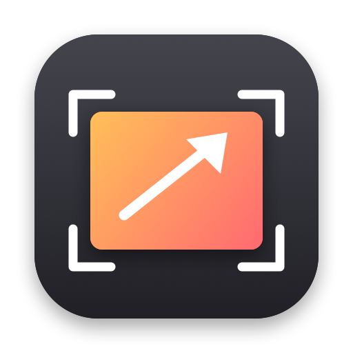
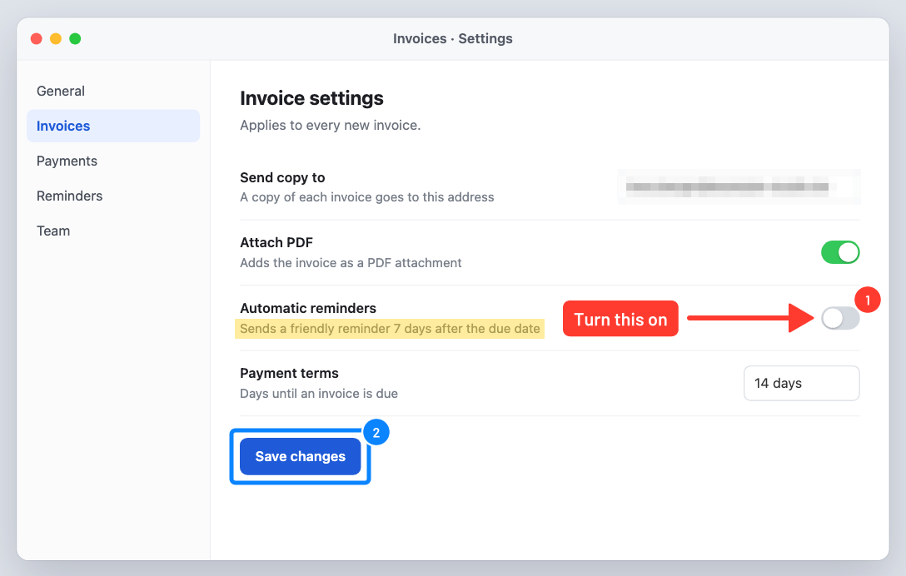

<p align="center">
  
</p>

<h1 align="center">Shotty</h1>

<p align="center">
  Screenshots and screen recordings from the macOS menu bar.<br>
  Freeze, select, annotate, record, trim, share. Written in Rust with GPUI.
</p>

<p align="center">
  <a href="https://mneuhaus.github.io/shotty/">Website</a> ·
  <a href="#install">Install</a> ·
  <a href="#keyboard-shortcuts">Shortcuts</a> ·
  <a href="#sharing-links">Sharing</a> ·
  <a href="#configuration">Configuration</a>
</p>

<p align="center">
  
  <br><sub>Exported from Shotty's editor: pixelate, highlighter, label, arrow, frame and numbered steps.</sub>
</p>

---

Shotty is a small, keyboard-first capture tool for the Mac. It started as a personal replacement for CleanShot X; the editor takes its cues from Shottr. It lives in the menu bar, uses ScreenCaptureKit for pixel-exact captures, and keeps everything on your Mac unless you press **Upload**.

## What it does

| Shortcut | What happens |
|---|---|
| **⇧⌘4** Capture area | The screen freezes. Drag an area, click a window, or press Space to pick windows. The PNG goes to `~/Pictures/Shotty` and to the clipboard, and the editor opens. |
| **⇧⌘3** Capture screen | Captures the display under the mouse, same as above. |
| **⇧⌘5** Record screen | Drag an area or click a window or the desktop, then press **Record** in the bar below it. Stop with the bar, ⇧⌘5 again or the red menu bar icon. Then trim the clip and export it. |

### Capture
- **Frozen frame.** Area capture freezes all displays first, so menus, tooltips and hover states stay put, and what you select is exactly what you get.
- **Fast.** The overlay is up about 20 ms after the shortcut; the frozen pixels follow while you are already dragging.
- **Every display at once**, menu bar included, with a crosshair, pixel coordinates and a live size readout (`1520 × 920`).
- **Window capture** takes the window on its own, with transparent corners.
- **Retina aware:** images are saved at full pixel resolution.
- **Image and file at once.** The clipboard holds the picture and the saved file, like CleanShot: chat apps and documents paste the picture, Finder pastes the file.

### Editor
- A Shottr-style window: the picture edge to edge, one toolbar with actions, tools and readouts (color under the cursor, image size, zoom). Drag the window by the empty part of the toolbar.
- Arrow, line, rectangle, ellipse, highlighter, text label, numbered steps, pixelate and crop.
- Seven colors and three stroke sizes behind the color button; select, move and delete shapes; unlimited undo.
- What you see is what you export: shapes are drawn live and rendered again at full resolution when you copy, save or upload.

### Recording
- Records an area of one display straight to H.264 MP4 at 30 fps.
- Shows the cursor and click rings. Microphone is optional; the toggle sits in the bar before you start.
- Shotty's own frame and control bar never appear in the video.

### Trim and export
After a recording, a clip window opens with a thumbnail strip. Drag the yellow edges to trim, then export:

| Export | Use it for | 30 s screen recording, measured |
|---|---|---|
| Recording as is | Archive | 16.6 MB |
| **MP4** (H.264, default) | Plays everywhere: browsers, Slack, WhatsApp, Mail | 2.1 MB |
| MP4, 1200 px wide | Sharing a full-screen recording | 1.1 MB |
| MP4 · HEVC | Smallest file; not every browser plays it | 1.7 MB |
| GIF | Short loops in places without video | 17.7 MB |

Measured on a generated 30 s clip with code text, a scroll and a moving cursor. Exports are written next to the recording; the original stays untouched. The exported file is put on the clipboard, ready to paste.

### Sharing links
**Upload** (⌘U in the editor, or the button in the clip window) sends the capture to your own server and copies a link. The link opens a small viewer page with a preview for chat apps and a download button. Links are unguessable (128 random bits), not listed anywhere and never expire. The menu bar has **Copy Last Upload Link** and **Delete Last Upload…**.

Nothing is uploaded unless you ask for it.

## Install

**Download:** the [latest release](https://github.com/mneuhaus/shotty/releases/latest) has Shotty.app for Apple Silicon. It isn't notarized: move it to Applications, then run `xattr -dr com.apple.quarantine /Applications/Shotty.app` once so macOS opens it. The download is signed ad hoc, so macOS asks for Screen Recording again after each update.

**From source:**

**Requirements**
- macOS 15.2 or later (ScreenCaptureKit's recording output and `captureImage(in:)`).
- Rust (stable) and Xcode with the Metal toolchain. If the build complains about `metal`, run `xcodebuild -downloadComponent MetalToolchain`.
- ffmpeg for exporting clips: `brew install ffmpeg`.

```sh
git clone https://github.com/mneuhaus/shotty.git
cd shotty
tools/bundle-macos.sh --install   # release build, signed, copied to /Applications
open /Applications/Shotty.app
```

On first use macOS asks for **Screen Recording** permission (and **Microphone** the first time you record with the mic on). Allow it, then quit and reopen Shotty.

> **Signing matters.** macOS ties the Screen Recording permission to the app's signature. The bundle script signs with the first "Apple Development" identity in your keychain, or with `$SHOTTY_SIGN`. With an ad-hoc signature macOS forgets the permission after every rebuild.

> **Coming from CleanShot X?** Quit it or remove its shortcuts first. Both apps want ⇧⌘3/4/5. A shortcut that is already taken shows up in Shotty's menu without its key.

## Keyboard shortcuts

**Selection overlay**

| Key | Action |
|---|---|
| Drag | Select an area |
| Click | Take the window under the cursor (the whole display on the desktop) |
| Space | Switch between area and window mode |
| Esc | Cancel |

**Editor**

| Key | Tool |
|---|---|
| `V` | Select and move |
| `A` | Arrow |
| `L` | Line |
| `R` | Rectangle |
| `O` | Ellipse |
| `H` | Highlighter |
| `T` | Text label (Enter to finish, ⇧Enter for a new line) |
| `N` | Numbered step |
| `B` | Pixelate |
| `C` | Crop (Esc clears it) |
| `1` to `7` | Pick a color |

| Key | Action |
|---|---|
| ⌘C | Copy and close (as image and as file; the capture file gets the annotations) |
| ⌘S | Save over the capture file |
| ⌘U | Save, upload, copy the link |
| Tab | Copy the color under the cursor (`#2A4A66`) |
| ⌘Z / ⇧⌘Z | Undo / redo |
| ⌫ | Delete the selected shape |
| Esc | Close (press twice when there are unsaved annotations) |

**Recording bar**

| Key | Action |
|---|---|
| Enter or Space | Start recording / stop recording |
| Esc | Cancel and discard |
| ⇧⌘5 | Start or stop from anywhere |

## Configuration

`~/Library/Application Support/Shotty/config.toml` is created with the defaults on first start. Changes apply on the next launch.

```toml
save_dir = "/Users/you/Pictures/Shotty"

[hotkeys]                       # modifiers: shift, super (⌘), ctrl, alt
capture_screen = "shift+super+Digit3"
capture_area = "shift+super+Digit4"
record = "shift+super+Digit5"

[recording]
fps = 30
show_cursor = true
show_clicks = true
microphone = false              # starting state of the mic toggle
system_audio = false

[upload]
url = "https://artifacts.neuhaus.nrw"
copy = "page"                   # "page" = viewer link, "direct" = the file itself (for Markdown)
# token_path = "/path/to/token" # default: ~/.config/artifacts/token
```

| Environment variable | Effect |
|---|---|
| `SHOTTY_FFMPEG` | Path to ffmpeg, if it isn't in `/opt/homebrew/bin`, `/usr/local/bin` or `PATH` |
| `ARTIFACTS_TOKEN` | Upload token, instead of the token file |
| `SHOTTY_CONFIG`, `SHOTTY_SUPPORT` | Use another config file or history folder |

## Upload server

Uploads go to an [artifacts](https://artifacts.neuhaus.nrw) server, a tiny self-hosted service for unlisted, link-only drafts. Its code isn't public yet. Any server with this contract works:

```http
POST /api/drafts?filename=Shotty%202026-10-08%20at%2013.12.06.png&description=…
Authorization: Bearer <token>
Content-Type: image/png            (also image/jpeg, image/gif, image/webp, image/avif, video/mp4, video/webm)

<raw file bytes>
```

```json
{ "id": "nvDQ3_fx6geVEMSmvIl8hg", "url": "https://host/nvDQ3_fx6geVEMSmvIl8hg/", "version": 1, "bytes": 3100843 }
```

`url` is the viewer page; the file itself lives at `<url>v/<version>/<filename>`. `DELETE /api/drafts/<id>` removes it. The token file must be readable only by you (`chmod 600`).

Every upload is listed in `~/Library/Application Support/Shotty/history.json`.

## How it's built

| Crate | |
|---|---|
| [`shotty-app`](crates/shotty-app) | The GPUI app: menu bar item, global hotkeys, selection overlay, editor, recording bar, clip window |
| [`shotty-capture`](crates/shotty-capture) | ScreenCaptureKit: displays, windows, screenshots, recordings via `SCRecordingOutput` |
| [`shotty-annotate`](crates/shotty-annotate) | The annotation model and full-resolution rendering with tiny-skia |
| [`shotty-media`](crates/shotty-media) | ffmpeg: probe, frames, frame-accurate trim, MP4 and GIF export with progress and cancel |
| [`shotty-share`](crates/shotty-share) | The upload client |

The UI uses [GPUI](https://www.gpui.rs) through [GPUI Kit](https://github.com/longbridge/gpui-kit). The few things GPUI doesn't do yet, such as the menu bar item and borderless overlay panels, are small AppKit calls via `objc2` in [`native.rs`](crates/shotty-app/src/native.rs).

## Development

```sh
cargo run -p shotty-app          # debug build, menu bar app
cargo test --workspace           # annotate, media (needs ffmpeg), share, hotkeys
```

`SHOTTY_DEMO` drives the UI without mouse or keyboard, for screenshots and smoke tests. Demo runs never touch the clipboard, and their windows don't take the keyboard (overlays are click-through).

| Value | Shows |
|---|---|
| `area`, `area-drag`, `area-window`, `area-cross` | The selection overlay, with a fixed drag, in window mode, or with the crosshair |
| `screen`, `screen-shapes` | A screen capture in the editor, optionally with one of every shape |
| `editor`, `editor-style` | The editor on `docs/assets/sample-before.png` (or `SHOTTY_DEMO_IMAGE`) with the website annotations, optionally with the color menu open. No capture, no keyboard focus |
| `screen-upload` | A capture uploaded straight from the editor |
| `record`, `record-auto` | The recording overlay, or a 3 s recording of a fixed area |

`cargo run --release -p shotty-capture --example timing` prints how long the capture path takes from shortcut to frozen frame.

The upload client has an integration test against a local artifacts server:

```sh
ARTIFACTS_TEST_URL=http://127.0.0.1:3999 ARTIFACTS_TOKEN=… cargo test -p shotty-share -- --ignored
```

## Not yet

Scrolling captures, text recognition (OCR), pinning captures to the screen, a built-in video player, notarized downloads. Intel Macs should build but aren't tested.

## Credits

[GPUI](https://github.com/zed-industries/zed) by Zed Industries · [GPUI Kit](https://github.com/longbridge/gpui-kit) by Longbridge · [screencapturekit-rs](https://github.com/doom-fish/screencapturekit-rs) · [tiny-skia](https://github.com/linebender/tiny-skia) · [Lucide](https://lucide.dev) icons · [Barlow](https://github.com/jpt/barlow) font by Jeremy Tribby (SIL Open Font License, [`OFL-Barlow.txt`](crates/shotty-annotate/assets/OFL-Barlow.txt)).

## License

[MIT](LICENSE) © Marc Neuhaus
